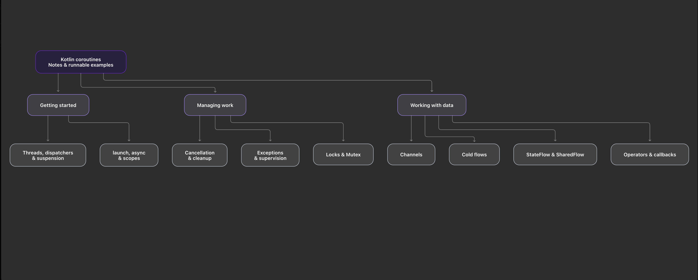

# Kotlin coroutines

These are my Kotlin coroutine notes and runnable examples. I use them to test ideas and understand
behavior that is easy to misread. Each example is small enough to read on its own.

The [learning history](docs/learning-history.md) explains how the examples and notes fit together.

## Start here

Read the topics in this order when learning the basics:

1. [Why coroutines](docs/topics/why-coroutines.md)
2. [Concurrency](docs/topics/concurrency.md)
3. [Suspension](docs/topics/suspension-in-coroutines.md)
4. [Coroutine best practices](docs/topics/coroutine-best-practices.md)
5. [Continuation](docs/topics/continuation.md)

The Kotlin examples live under `app/src/main/java/coroutines`. Most files have a top-level `main`
function, so they can be run as individual examples from Android Studio. The package names follow
the topic names, such as `coroutines.basics` and `coroutines.flows.hot.state`.

## Topics

- `basics`: threads, dispatchers, suspension, and coroutine basics
- `coroutinebuilders`: `launch`, `async`, `runBlocking`, scopes, and sequences
- `cancellation`: cooperative cancellation, cleanup, and supervisor jobs
- `channels`: producer and consumer communication through channels
- `flows/cold`: cold flows and flow builders
- `flows/hot`: `SharedFlow` and `StateFlow`
- `flows/practicalexamples`: flow operators, callback conversion, and a timer flow
- `continuation`: the continuation used to resume suspended work
- `exceptions`: exception propagation, handlers, and supervisor scopes
- `synchronization`: JVM locks, `Mutex`, and single-thread dispatchers

The longer notes that are not Kotlin source live in [`docs/topics`](docs/topics). They are part of
the same learning record and are linked from the relevant sections above.

The [reference notes](docs/README.md) collect the topic links in one place. The
[coding conventions](docs/coding-conventions.md) explain the choices used in the examples.

## Run the project

Open the project in Android Studio and run the standard debug build. The project targets Android API
35, uses Java 11 bytecode, and includes `kotlinx-coroutines-core` for the standalone examples.

Several standalone examples use `runBlocking` to wait for their coroutines before the entry point
returns. Android app work should use a lifecycle-owned scope, such as `viewModelScope` or
`lifecycleScope`.

## Notes on the examples

- `GlobalScope` is discussed as a learning topic, but the runnable examples use an explicit owner
  when one is available.
- Cancellation examples use `NonCancellable` only for short cleanup work that must finish after
  cancellation.
- The synchronization example describes nested `Mutex.withLock` as a deadlock case without running
  it, so the example can finish when executed.
- A flow collector owns the work it starts. Cancel the collector to stop an infinite flow such as
  `timeAndEmit`.
